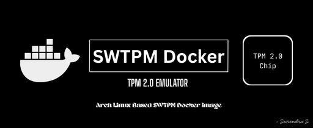

SWTPM Docker Arch
=================

A ready-to-use Docker image for [**SWTPM**](https://github.com/stefanberger/swtpm), a software-based TPM 2.0 emulator, built on Arch Linux and installed directly from the official pacman repositories.


Usage
-----

Installing SWTPM-Docker-Arch
```sh
git clone https://github.com/SurendraS26/swtpm-arch-docker.git
cd swtpm-arch-docker
docker build -t swtpm-arch -f Dockerfile .
docker run -p 127.0.0.1:2321-2322:2321-2322 swtpm-arch 
```
>Note : Since Arch is rolling distro, containers are tested and then released.

Connect using [`tpm2-tools`](https://github.com/tpm2-software/tpm2-tools):

```sh
tpm2_startup -T swtpm:host=127.0.0.1,port=2321 -c
tpm2_pcrread --tcti="swtpm:host=127.0.0.1,port=2321" sha256
```

TCTI configuration for TSS2:
```
swtpm:host=127.0.0.1,port=2321
```

Requirements
------------

- Docker
- `tpm2-tools` on the host


Acknowledgement
----------------

This image bundles [**SWTPM**](https://github.com/stefanberger/swtpm) and [**libtpms**](https://github.com/stefanberger/libtpms) (IBM Corporation, 3-Clause BSD), and is built on [**Arch Linux**](https://archlinux.org/), whose components carry their own respective open-source licenses.


